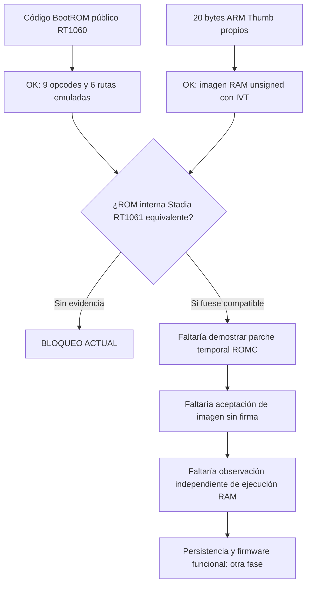

# Fase 100 — BootROM Thumb real en Unicorn + imagen RAM unsigned para ensayo offline

**Corte: 24 de noviembre de 2026. Sin conectar hardware; sin ejecutar el exploit SDP.**

## Resumen ejecutivo

Ahora se ha probado **dinámicamente un fragmento de código máquina de la BootROM pública RT1060**, no solo un desensamblado. El emulador Unicorn de CPU Thumb con RAM sintética ha reproducido seis caminos de longitud del manejador HID. Se ha preparado además una **imagen de prueba RAM con IVT y Boot Data** sobre un programa ARM compilado por nosotros. Son **dos pruebas offline independientes**.

**No se ha demostrado que el RT1061 específico del Stadia comparta esta ROM, acepte el exploit, reciba esa imagen o ejecute firmware sin firma en hardware real.**

## I. Evidencia de ROM real para la ruta HID

**Fuente original, inspeccionada:** `/mnt/data/nxp-sdp-overrun-main.zip` en conversación, `README.md` y `main.py`. El autor `tchebb` asocia el exploit a la BootROM RT1060 HAB 4.3.7, hash `a5d9af17f0e21866774df91c1e634e955e72b1442aedd84c8aac8eefc8e58f8e`.

**ROM pública:** `Zenofex/SoC-BootROMs/nxp/imxrt1060.bootrom.bin`, 131072 bytes. Se descarga en GitHub Actions y se exige el hash exacto **antes de ejecutarla en el emulador**. No es un dump de nuestra unidad Stadia.

**Código:** [`research/phase100/emulate_hid_callback.py`](../../research/phase100/emulate_hid_callback.py)

- Se mapean 128 KiB de BootROM pública como lectura/ejecución y áreas sintéticas de DTCM y OCRAM.
- Se inicializan **solo** registros y campos ficticios para entrar en el tramo `sdp_hid_callback + 0x46`; **no** se simulan funciones anteriores, USB HID completo, ROMC, HAB ni el procesador de la placa.
- Antes de permitir instrucciones se verifican las **9 firmas de opcodes** en la ROM SHA-pinned.
- La emulación termina antes de ejecutar el retorno, y rechaza otras escrituras salvo el campo `reportBuffer` de la estructura ficticia.

**Resultados reales del emulador** [CI #45369756474](https://github.com/JaimeDelgadoNaya/stadia-controller-research/actions/runs/45369756474):

| Longitud sintética | Rama | `reportBuffer` registrado | `R0` |
|---:|---|---|---:|
| 0 | aceptada | `0x2020723F` | 0 |
| 1 | aceptada | `0x2020723F` | 0 |
| 2047 | aceptada | `0x2020723F` | 0 |
| 2048 | aceptada | `0x2020723F` | 0 |
| 2049 | rechazada | `0x00000000` | 5 |
| 4096 | rechazada | `0x00000000` | 5 |

**9/9 tests** de validación de hash, rangos, límites de ejecución y tamaño pasan en CI. Es una prueba **CPU-dependiente y dinámica** de la elección de puntero de esa ROM. No hemos hecho copiar 2048 bytes reales mediante el USB de NXP; el cálculo de tres bytes de solapamiento ya fue verificado estáticamente en fase 98.

## II. Imagen propia de prueba, encapsulada con IVT

Se reutilizó el demo ARM Thumb de fase 97, compilado **desde `minimal_ram.S` y `ram_only.ld` en la CI**, SHA-256 `68a75935017e47c373d2df0b9294c31781705894511bc62fea78b6a265806f38`, 20 bytes. No tiene drivers, no toca fusibles, flash ni periféricos y solo escribe un marcador en RAM en la **simulación anterior**.

Formato de envoltura elaborado por nuestro script original [`research/phase100/build_unsigned_ram_image.py`](../../research/phase100/build_unsigned_ram_image.py):

| Campo | Valor de ejemplo |
|---|---|
| Dirección RAM de carga | `0x20000000` |
| Longitud total de imagen | **8192 bytes** |
| IVT / `self` | `0x20000400` (archivo +`0x400`) |
| IVT encabezado | `0x412000D1` |
| `entry` | `0x20000009`, Thumb |
| Boot Data | `0x20000420` |
| Boot Data `start,size,plugin` | `0x20000000,8192,0` |
| DCD | Nulo |
| CSF | Nulo |
| SHA-256 imagen unsigned | `ac958c5e9d482b748a6ea8b771477c0cd4c2a7696eff14c4944db281e1808796` |

El formato IVT/Boot Data se basa en **NXP MCUXpresso Manufacturing User Guide**: https://mcuxpresso.nxp.com/mcuxsdk/25.06.00/html/middleware/mcu_bootloader/docs/iMXRT1060_Manufacturing_User_Guide/topics/imx_rt_bootable_image.html

**8/8 tests** de estructura y tamper resistance pasan en la misma CI; el script no incluye una conexión SDP ni instrucciones de flashing, y el pipeline publica **solo un informe JSON**, no el binario.

**LÍMITE:** este ejemplo **no ha sido aceptado por la ROM** ni validado contra periféricos, alimentación, memoria ocupada o estado HAB del Stadia. Que exista una estructura IVT válida en nuestro parser no prueba que funcione como imagen completa de arranque. Un Stadia con HAB CLOSED rechazaría normalmente imágenes sin firma sin un bypass físico previamente demostrado. **NO ejecutar ni flashear sobre el único mando.**

## III. Actualización de fuentes externas

- NXP confirmó que `USB_ANALOG->DIGPROG=0x006C0000` identifica la **familia RT106x**, no el modelo o variante exactos. https://community.nxp.com/t5/i-MX-Processors/Device-Identification-Register/td-p/1528156
- Una **PCN de NXP del 02/03/2022** documenta el nuevo `mask set 1N00X` y números de pieza con sufijo **B** para RT1061 y RT1062, además de una corrección de comportamiento USB respecto al silicio previo. No podemos atribuir al mando del usuario un mask set sin leer su marcado o procedencia; el identificador RT106x no es una prueba de que ROM A y B coincidan. https://www.nxp.com/pcn/202007035F01U01
- En noviembre de 2026, `tchebb` afirma tener un port Zephyr para Stadia todavía sin release. Otro miembro informó el **16/11/2026** haber conseguido una prueba persistente de firmware propio **tras activar el fusible `FIELD_RETURN`**, acción irreversible. Ambas son **declaraciones públicas comunitarias**, no pruebas independientes de compatibilidad con la unidad que investigamos. https://www.reddit.com/r/Stadia/comments/1xwcedq/has_anyone_bypassed_the_bootloader_signage/
- La búsqueda del 24/11/2026 no identificó un repositorio público verificable con el port Zephyr Stadia de `tchebb`. No inventar releases.

## IV. Puertas que quedan

**NO-GO:** No usar `--permanent`, no programar `FIELD_RETURN` ni otros eFuses, no escribir flash y no asumir que una emulación es una prueba física.

## Artefactos

- [Emulador de ruta real RT1060](../../research/phase100/emulate_hid_callback.py)
- [9 tests sintéticos/fail-closed](../../tests/test_hid_rom_emulation_phase100.py)
- [Generador offline de imagen unsigned para demo ARM](../../research/phase100/build_unsigned_ram_image.py)
- [8 tests IVT y Boot Data](../../tests/test_unsigned_ram_image_phase100.py)
- [Workflow reproducible](../../.github/workflows/phase100-hid-rom-emulation.yml)
- [CI con 17/17 tests y 6 trazas CPU](https://github.com/JaimeDelgadoNaya/stadia-controller-research/actions/runs/45369756474)

**Decisión:** La emulación y el empaquetado reducen dos riesgos de ingeniería, pero todavía no eliminan la barrera de ROM exacta ni prueban ejecución física en RT1061.
