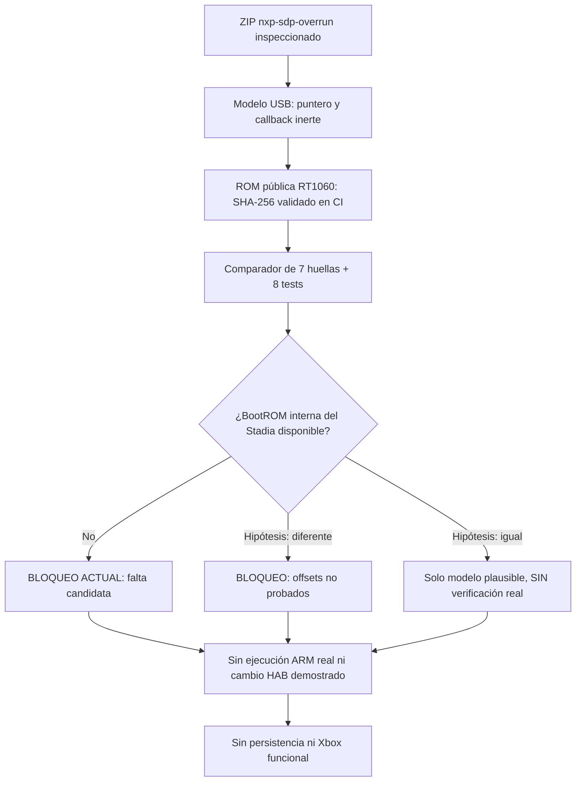

# Fase 95 — Simulación de estado del proyecto Stadia (SIN hardware)

**24/11/2026.** Se reejecutó contra el ZIP del usuario el auditor `offline_audit.py`: **7/7 PASS**. Se reejecutaron las pruebas del comparador de BootROM: **8/8 PASS**. Se construyó una **máquina de estados documental independiente** con cuatro escenarios y ocho comprobaciones: **8/8 PASS**. Total **23/23 comprobaciones offline**, no 23 pruebas físicas.

## Esquema de barreras

## Base de datos frente a simulación

- **Observaciones reales anteriores**, registradas el **25/10/2026**: ROM SDP `1FC9:0135`; HAB CLOSED `0x12343412`; identificador `0x006C0000` de familia RT106x. Fuente: `docs/es/mediciones.md` y `evidence/rom-status.json`. La fase 95 **no** conecta hardware.
- **7 tests estructurales** sobre el código recibido de tchebb, con importaciones USB y Keystone sustituidas por mocks, y un callback de instrucciones ARM inocuas. Prueban coherencia estructural, no una explotación efectiva.
- **ROM de referencia pública** `imxrt1060.bootrom.bin` descargada y verificada por SHA-256 mediante [GitHub Actions fase 94](https://github.com/JaimeDelgadoNaya/stadia-controller-research/actions/runs/45348902534), con siete huellas de 64 bytes; no es un dump del Stadia.
- **8 pruebas del comparador** superadas: tres categorías de divergencia y estados `CANDIDATE_MISSING`/equivalencia sintética, sin atribuir la ROM pública a la unidad del usuario.
- **8 pruebas del nuevo modelo de estados** superadas localmente: caso actual detenido por ROM interna ausente; caso hipotético coincidente no acredita bypass; caso hipotético diferente queda bloqueado; intento de fusión OTP queda rechazado. Ninguna prueba usa USB, OTP, flash ni compilación real del shellcode.

## Resultados de los cuatro escenarios virtuales

| Escenario | Resultado |
|---|---|
| Evidencia real disponible | `BLOCKED_MISSING_INTERNAL_ROM` |
| BootROM candidata idéntica **inventada** | `MODEL_CAN_CONTINUE_BUT_NO_HARDWARE_PROOF` |
| BootROM candidata diferente **inventada** | `BLOCKED_HYPOTHETICAL_INCOMPATIBILITY` |
| Ruta irreversible `FIELD_RETURN` | `STOP_UNSAFE_PATH` |

Los cuatro escenarios son decisiones lógicas del modelo, no una emulación de procesador, ROM, periféricos USB ni HAB. El modelo declara siempre **false** para ejecución real de firmware propio y desbloqueo HAB.

## Lo pendiente para el objetivo Xbox

1. Identificar de forma verificable la BootROM interna del RT1061 (no confundir con la flash NOR externa obtenida anteriormente).
2. Demostrar sobre hardware recuperable que la ruta de USB SDP de esa ROM es compatible.
3. Separar ejecución temporal, persistencia y recuperación ante fallos.
4. Desarrollar XInput para Windows o un puente externo; la autenticación de Xbox física es un requisito diferente.

**Regla NO-GO:** nunca usar `--permanent`, `FIELD_RETURN`/OTP ni escribir el único mando en esta fase. La observación HAB CLOSED no es un bypass.

Las pruebas y el informe detallado se generaron también como artefacto local para compartir con el usuario.
